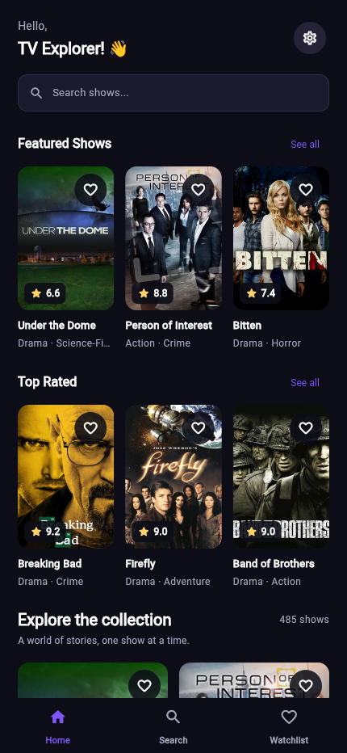
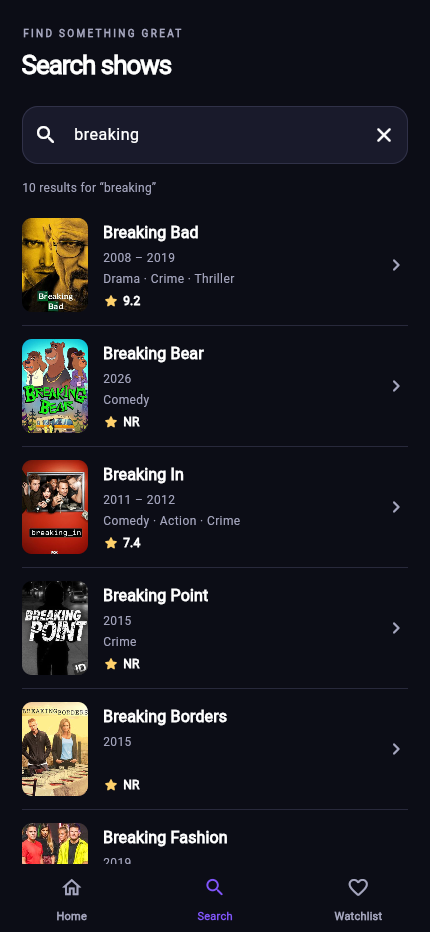
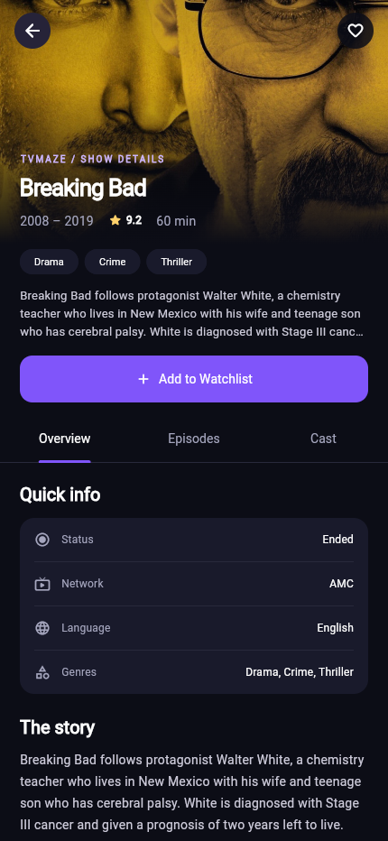
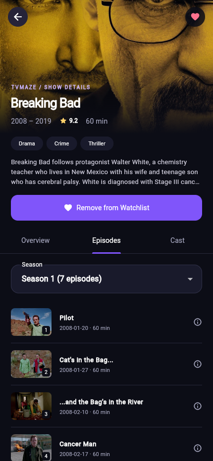
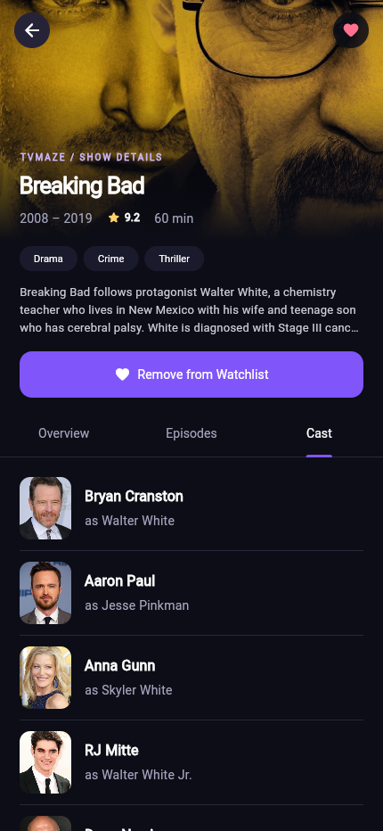
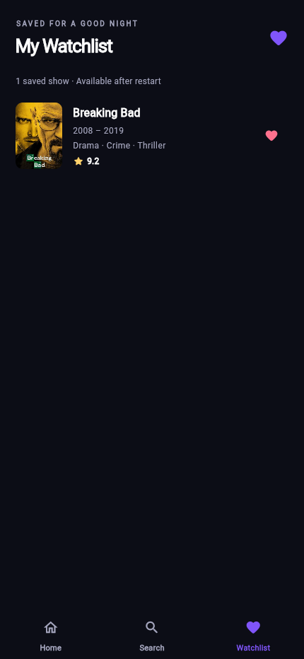
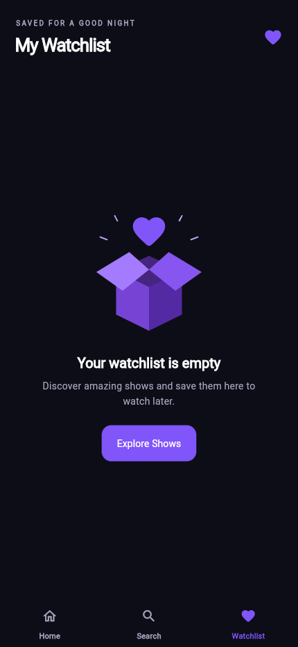

# TVMaze Discovery

**CS4039 – Software for Mobile Devices | Assignment 02**

TVMaze Discovery is a Flutter app for browsing TV shows, looking up cast and episode information, and keeping a personal watchlist. It uses the public TVMaze API and BLoC for state management.

The interface uses a dark theme with purple accents, poster cards, and separate screens for discovery, search, show details, and saved shows.

## Features

- Browse shows with posters, titles, genres, and ratings.
- Scroll to load more shows, or pull down to refresh the collection.
- Search by name with a 400 ms debounce to avoid sending a request for every keystroke.
- View a show's summary, rating, genres, status, network, and language.
- Browse cast members and episodes grouped by season.
- Add or remove shows from the watchlist and keep them saved after reopening the app.
- Retry failed requests and see clear messages when results or information are unavailable.

Show information comes from TVMaze. The Featured Shows and Top Rated sections use the records already loaded from the API.

## Getting started

### Requirements

- Flutter 3.35.7 with Dart 3.9.2, or a compatible newer version
- An internet connection to fetch shows and images
- Chromium or Chrome for the web version
- JDK 17 and the Android SDK for Android development

### Run the project

Open a terminal in the project folder and run:

```bash
flutter pub get
flutter run
```

To run in Chromium on Linux:

```bash
export CHROME_EXECUTABLE=/usr/bin/chromium
flutter run -d chrome
```

### Run from VS Code

1. Open the project folder in VS Code.
2. Install the Flutter extension, which also installs the Dart extension.
3. Open **Run and Debug** and choose **TVMaze · Chrome** or **TVMaze · selected device**.
4. Press **F5**.

The Chrome launch configuration uses `/usr/bin/chromium`. Update this path in `.vscode/launch.json` if your browser is installed elsewhere. If VS Code cannot find Flutter, use **Flutter: Change SDK** to select your SDK folder.

### Setup scripts for Linux

If Flutter is not installed, the setup script downloads Flutter 3.35.7 to `~/develop/flutter` and prepares the project:

```bash
bash scripts/setup.sh
```

It requires Linux x86_64, Git, curl, Python 3.11+, tar, xz, and unzip. To use that SDK from a terminal:

```bash
export PATH="$HOME/develop/flutter/bin:$PATH"
```

To set up the Android tools:

```bash
bash scripts/setup_android.sh
```

This installs JDK 17 and Android SDK components locally and prompts you to review the Android licenses. You can also use an existing Android Studio installation.

### Build an Android APK

Connect a phone with USB debugging enabled, or start an Android emulator:

```bash
flutter devices
flutter run -d <device-id>
```

To build a debug APK:

```bash
flutter build apk --debug
```

The APK is saved to `build/app/outputs/flutter-apk/app-debug.apk`. The Android configuration targets API 24 and above and uses Java 17. Release builds currently use the debug signing key for classroom installation.

## Project structure

```text
lib/
  main.dart              App startup and local storage
  app.dart               App theme and dependency setup
  core/                  Shared theme, statuses, and error handling
  data/                  Models, API repository, and watchlist storage
  features/
    discover/            Show loading and pagination BLoC
    search/              Debounced search BLoC
    details/             Show details, cast, and episodes BLoC
    watchlist/           Saved shows BLoC
  presentation/
    screens/             Application screens
    widgets/             Reusable cards, rows, buttons, and status messages
```

## State management

The app has four BLoCs: discovery, search, details, and watchlist. Screens send events to these BLoCs and rebuild when a new state is emitted. API calls and local storage operations are kept in repositories rather than UI widgets.

For example, entering a search sends a `SearchQueryChanged` event. The search BLoC waits 400 ms before calling the repository, then emits a success, empty, or error state. If the query changes while a request is running, the older result is ignored.

Watchlist changes are processed one at a time. The saved list is updated only after the local write succeeds, so a failed save does not leave the screen showing a change that was never stored.

## Local storage

SharedPreferences stores show metadata as JSON using the key `tvmaze.watchlist.v1`. Saving the metadata alongside the show ID lets the watchlist display titles and summaries without fetching them again.

New searches and uncached images need an internet connection. Clearing app data or browser site storage removes the saved watchlist.

## API endpoints

| Feature | Endpoint |
| --- | --- |
| Browse shows | `https://api.tvmaze.com/shows?page=0` |
| Load the next page | `https://api.tvmaze.com/shows?page=1` |
| Search shows | `https://api.tvmaze.com/search/shows?q=dark` |
| Show details | `https://api.tvmaze.com/shows/{id}` |
| Cast | `https://api.tvmaze.com/shows/{id}/cast` |
| Episodes | `https://api.tvmaze.com/shows/{id}/episodes` |

No API key is needed. Show data and images are provided by [TVMaze](https://www.tvmaze.com), under the terms listed in its [API documentation](https://www.tvmaze.com/api#licensing).

## Tests

Run the automated tests and static analysis with:

```bash
flutter analyze
flutter test
```

The tests cover API parsing and failures, pagination, search debounce, outdated responses, watchlist persistence, failed saves, season grouping, and screen navigation. The latest test run passed all 36 unit and widget tests. The release web build and live browser flow also passed. Android APK and on-device verification still need to be completed.

For the full browser check, including screenshot capture:

```bash
bash scripts/audit.sh
```

This requires Chromium and a matching ChromeDriver. The GitHub Actions workflow also runs analysis and tests, then builds the web app and an Android debug APK.

## Screenshots

The following screenshots show the app running in Chromium with TVMaze data.

<!-- screenshots:start -->
**Discover**



**Search**



**Details**



**Episodes**



**Cast**



**Watchlist**



**Empty watchlist**


<!-- screenshots:end -->

To update the screenshots:

```bash
bash scripts/screenshots.sh chrome
```

For an Android device, replace `chrome` with its device ID. The capture test uses a separate storage key so it does not change your personal watchlist.
